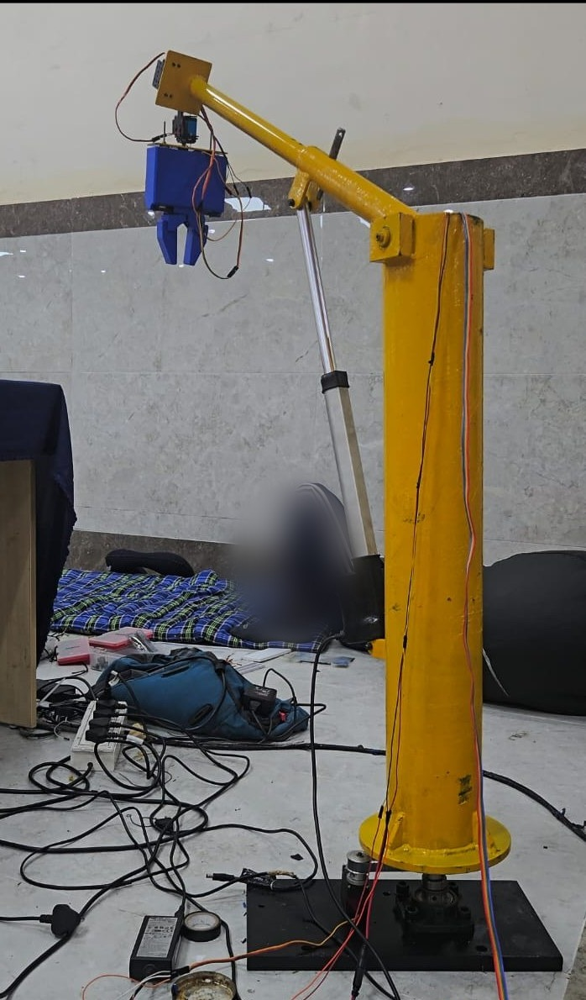
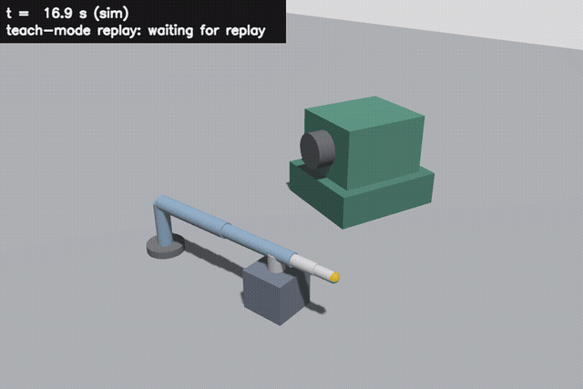
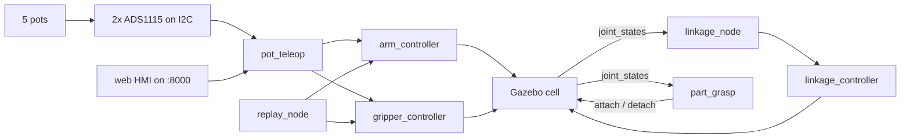
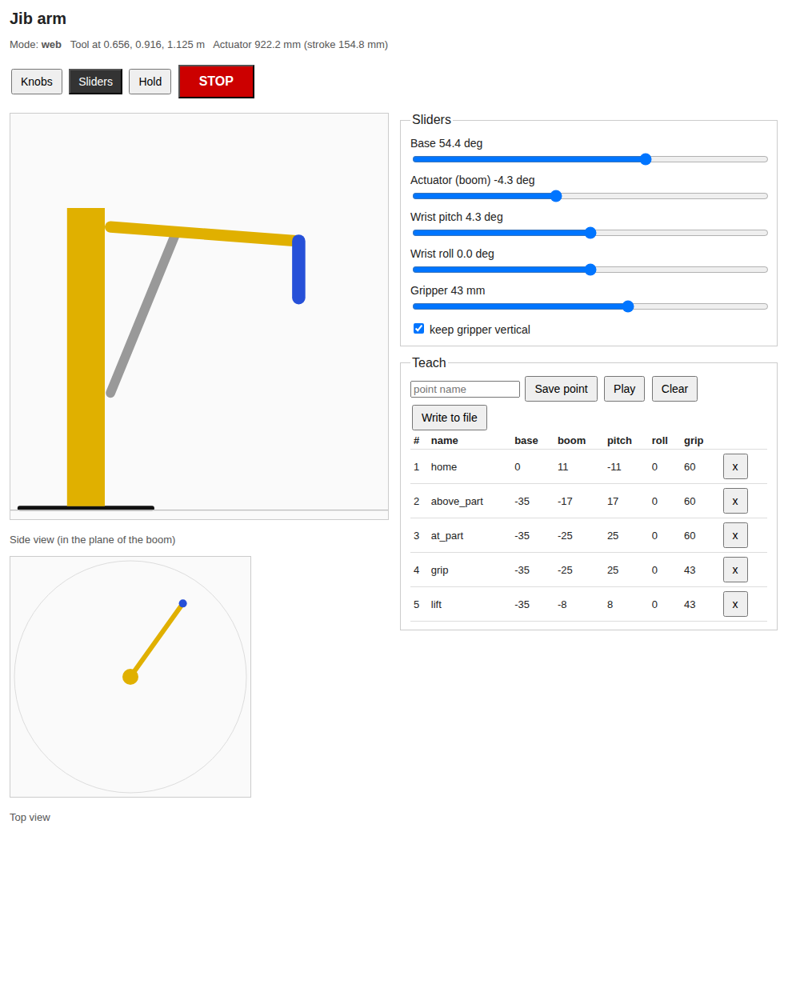
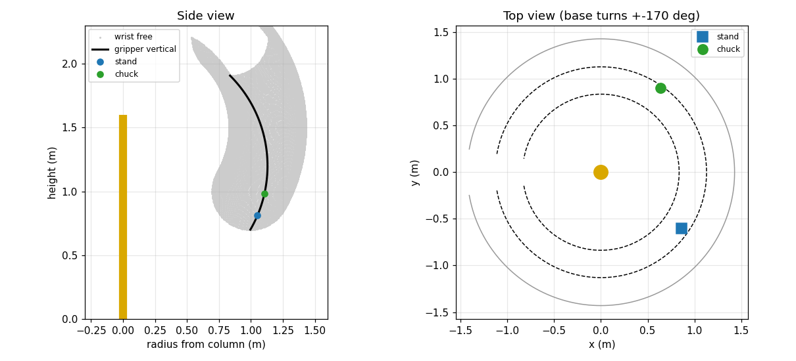
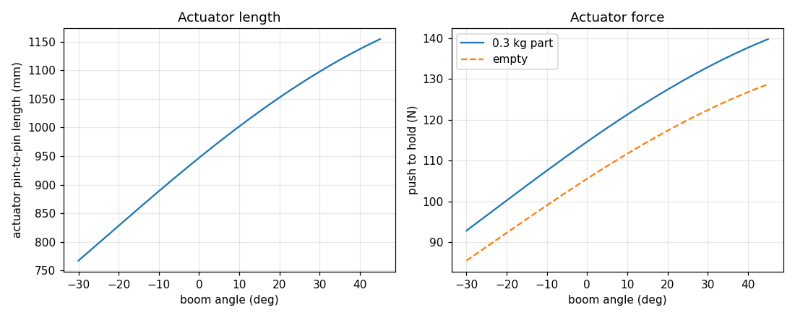

# cnc-lathe-arm

[](https://github.com/MaharajLMR/cnc-lathe-arm/actions/workflows/ci.yml)

A 5-axis jib arm that takes a billet off a job tray and loads it into the chuck of a horizontal CNC lathe, rebuilt in ROS 2 Jazzy and Gazebo Harmonic.

This is a rebuild of the robot my team made for the DriveNext RANE SLD Hackathon 2026, where we came 1st runner-up. It is not the hackathon code. I wrote this repo afterwards from the photo and the few dimensions I know, so the arm can be moved and tested in simulation.



Someone was sitting behind the arm when I took this, so that part is blurred.

The real robot was a jib crane style arm. A black base plate with a slewing bearing turned a yellow steel column. A yellow boom was lifted by a silver linear actuator, and at the tip there was a wrist servo and a blue two-finger gripper. Every axis was driven from a potentiometer knob. A Raspberry Pi 5 read the knobs and also served a web page (the HMI).



That is the example cycle in Gazebo: take a billet out of its pocket in the tray, turn it a quarter turn so it lies along the spindle, swing round, slide it into the chuck, let go and come home.

## What I measured and what I guessed

From the real robot: it has 5 DOF, the column is about 1.5 m from the base plate to the boom pivot, and the boom is about 1.0 m.

Everything else is estimated from the photo: the 0.13 m pivot offset, where the actuator is mounted (0.62 m up the column, 0.35 m along the boom), the 0.30 m from the wrist axis to the fingertips, the joint limits, the actuator rod length and all the masses. The actuator stroke below comes from those guesses, so treat it as a sizing exercise, not a measurement.

## How it fits together



- `pot_teleop` turns pot readings (0 to 1 each) into joint targets. The boom knob maps to actuator stroke, like the real actuator, and is converted to a boom angle. Readings are smoothed and a small deadband stops a noisy pot from making the arm twitch.
- `hmi_server` is the web page. It has sliders that act as virtual pots, a live side and top drawing of the arm, a stop button, a keep-gripper-vertical toggle, and a teach list (save, delete, play, write to `~/lathe_arm_points.yaml`).
- `linkage_node` moves the drawn actuator (two extra joints, `act_pitch` and `act_extend`) so it stays attached to the boom. URDF can't describe that closed loop, so this is a visual fix only.
- `part_grasp` is sim only. Gazebo is bad at holding things with finger friction, so a detachable joint holds the billet. The node attaches it when the fingers close within 6 cm of it and lets go when they open. The chuck has a second detachable joint: the spindle is horizontal, so without it the billet would drop on the floor the moment the fingers opened.
- `replay_node` plays a points file: arm first, then gripper.

## Running it

```bash
mkdir -p ~/ros2_ws/src && cd ~/ros2_ws/src
git clone https://github.com/MaharajLMR/cnc-lathe-arm.git
cd ~/ros2_ws && colcon build && source install/setup.bash

ros2 launch lathe_arm_bringup sim.launch.py
```

Then open http://localhost:8000 for the HMI. To play the example cycle:

```bash
ros2 run lathe_arm_teach replay_node --ros-args -p waypoints:=$(ros2 pkg prefix lathe_arm_teach)/share/lathe_arm_teach/waypoints/example_load_cycle.yaml
```

`tools/run_cycle_demo.sh <out_dir>` does a headless run and records both cell cameras, and `tools/make_demo_video.sh` turns them into the gif and mp4. The second camera sits inside the guards by the tailstock, because the wide one has to shoot past the column and ends up too far back to see the billet go in.



### The load cycle


The gripper is 0.030 m per finger when open and 0.0215 m when closed on the 50 mm billet.

I don't write those angles by hand any more. The cell dimensions are in `lathe_arm_teach/cell.py` and `tools/make_waypoints.py` solves the arm for them and writes the YAML, so moving the lathe is one number.

### Why the billet goes in sideways

A lathe chuck faces sideways, not up, so the billet has to travel along the spindle axis to get in. This arm only has one motion that is horizontal and keeps the gripper level, and it is the base swing: lifting the boom moves the gripper up and outwards at the same time, so there is no way to push straight out while staying flat. Fixing the wrist level leaves one degree of freedom, and the fingertips trace a circle.

So the machine is set side-on to the arm, with the spindle running across the arm's view, and the insertion is a base swing. The billet comes off the tray lying radially, which is how the fingers can close across it, and a quarter turn of the wrist puts it along the spindle before it goes anywhere near the machine.

The swing is an arc and the spindle is a straight line, so they only touch at one point. Over the 130 mm of insertion that is 7 mm of drift, which the solver takes out of the boom and wrist instead, leaving the gripper 1.5° off level at the start of the push. `tests/test_waypoints.py` fails if that goes past 2.5°.

### On a Pi

`ros2 run lathe_arm_teach pot_teleop --ros-args -p source:=ads1115` reads real pots. The wiring the code expects is in [hardware/README.md](hardware/README.md). The ADS1115 path is only tested through the conversion functions, not on a real board.

## Numbers

Each of these comes from a script in `analysis/` and uses the estimated dimensions above.

- Actuator (`actuator_sizing.py`): the boom range of -30 to 45 degrees needs a 387 mm stroke (767 to 1154 mm). The moment arm is 189 to 350 mm. The peak push is 140 N at 45 degrees with a 0.3 kg part, so I would pick an actuator rated for 300 N or more.
- Workspace (`workspace.py`): with the gripper kept vertical it reaches 0.84 to 1.13 m out and 0.70 to 1.91 m high. The tray (r 1.052) and the chuck (r 1.106) are both inside that, which is what fixes where they go: pick the heights and the radii follow.
- Pot resolution (`pot_resolution.py`): the deadband is 1.36 degrees at the base and 1.55 mm on the actuator, which is about 4.9 mm at the gripper.
- Cycle time (`cycle_time.py`): the cycle is 38.0 s with a fixed 3 s per move and 24.5 s when each move gets the time its slowest joint needs. In one Gazebo run `replay_node` took 38.9 s from start to finish, which also includes the first move from the zero pose to home. That is a single run, I haven't averaged several.




## Tests

`python3 -m pytest tests` needs no simulator. It checks the kinematics (forward and inverse, actuator length and angle), the pot mapping and filter, the move timing, and that the waypoints are inside the limits and put the fingertips within 1 cm of the tray and chuck grip points, that the billet goes in along the spindle axis and not across it, and that the world file still agrees with the cell geometry. One test builds the URDF with `xacro` and checks the joint chain against `arm_model.py`, including that the drawn actuator rod meets the boom. The tests that import ROS are skipped if it isn't sourced.

## Simulated only

- All the motors. Gazebo joints follow the commands, there is no motor model.
- The grip. The part is held by a detachable joint, and the fingers have no collision.
- The lathe and the tray are just shapes. Nothing cuts, the spindle does not turn, and the chuck jaws do not move: a second detachable joint stands in for them.

## Things I would like to do

- Wire the pots to a Pi and try the ADS1115 path on the real boards.
- Measure the real robot properly and replace the guessed dimensions.
- Give the fingers collision and a real grasp instead of the detachable joint.

MIT license.
