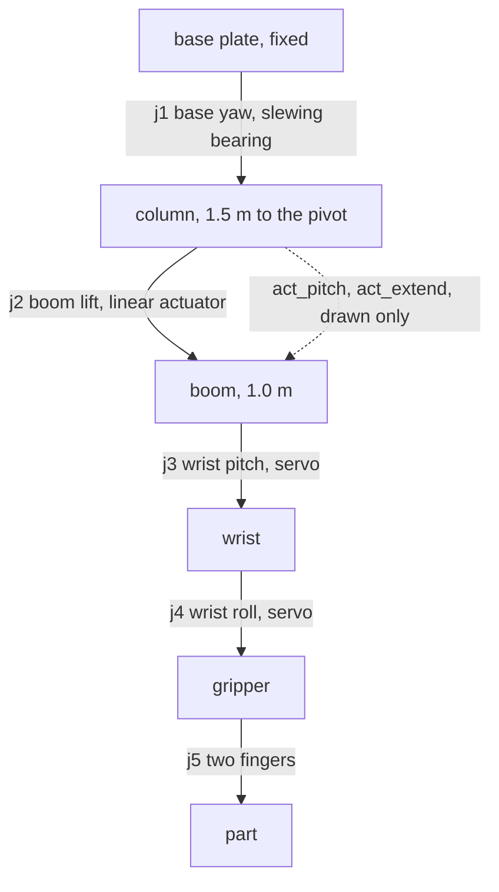

# Design notes

## Joints

I haven't corrected this layout against the real robot, it is the one the code uses.

| joint | what | range |
|---|---|---|
| j1 | base yaw, motor and slewing bearing | ±170° |
| j2 | boom lift, linear actuator | -30° to 45° |
| j3 | wrist pitch, servo | ±135° |
| j4 | wrist roll, servo | ±90° |
| j5 | gripper, each finger | 0 to 0.035 m |

The ranges are my estimates. Home is j2 = 10° and j3 = -10°, which is the gripper hanging straight down.

## Dimensions

Measured on the real robot: the column is about 1.5 m from the base plate to the boom pivot, and the boom is about 1.0 m.

Estimated from the photo: the pivot sits 0.13 m ahead of the column axis, the actuator's lower mount is 0.62 m up the column, its upper mount is 0.35 m along the boom, and the fingertips are 0.30 m below the wrist axis. The same numbers are at the top of `arm_model.py` and in the URDF, and `tests/test_urdf.py` checks they agree.

## The actuator

The boom is not driven by a joint motor, it is pushed by a linear actuator. With the lower mount at L and the upper mount at distance b along the boom from the pivot P, the actuator length is the distance between the two mounts, which depends on the boom angle. `arm_model.actuator_length` computes that, and `boom_angle` inverts it with the law of cosines. The round trip is tested.

The boom knob on the pot box is mapped to actuator stroke (387 mm), not to angle, because that is what the real knob moved. The angle is worked out from the stroke.

URDF can't have a closed loop (column, actuator, boom), so the drawn actuator is two extra joints: `act_pitch` turns the actuator body and `act_extend` slides the rod out. `linkage_node` reads the boom angle and commands them. Nothing in the dynamics depends on them. A test checks that the rod tip lands on the boom attach point for several boom angles.

## Keeping the gripper vertical

Fingertips are straight below the wrist when j3 = -j2. The HMI has a toggle for this, and it is on by default, because a part dropped into a chuck should go in straight. The toggle only affects the pot and HMI path. The waypoints in the example cycle already have it built in.

## Move timing

Joint speeds are limited to 0.5, 0.35, 1.5 and 1.5 rad/s for j1 to j4, a bit under the URDF limits. `pot_teleop.move_time` gives the time the slowest joint needs. The trajectory controller does not move at a constant speed, its spline peaks at about 1.9 times the average. If a move is given only the average time the base hits its velocity limit in Gazebo and overshoots by more than a radian before coming back. So `replay_node` stretches each move by 1.9, and after each move it waits until `/joint_states` is within tolerance of the target before going on.

## The Gazebo cell

`lathe_arm_bringup/worlds/lathe_cell.sdf` has the part stand, a 50 mm by 100 mm part, a vertical lathe with the chuck facing up, a yellow circle on the floor and the camera used for the recordings. The grip point on the stand is (0.855, -0.599, 0.793) and the chuck grip point is (0.614, 0.877, 0.858). `tests/test_waypoints.py` checks the `at_part` and `at_chuck` points put the fingertips within 1 cm of those.

The part is held by a detachable joint (see `part_grasp.py`), not by finger friction.

## Running the cycle

In the last headless run the part ended at (0.614, 0.877, 0.898), which is in the chuck, with one attach and one release in the log. `replay_node` took 28.9 s for the whole file in that run.
