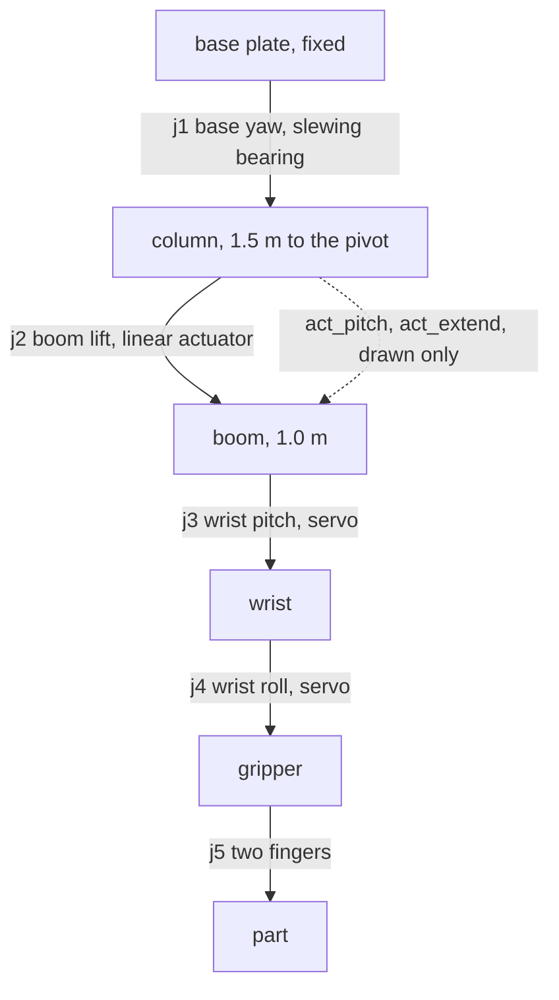

# Design notes

## Joints



I haven't corrected this layout against the real robot, it is the one the code uses.

| joint | what | range |
|---|---|---|
| j1 | base yaw, motor and slewing bearing | ±170° |
| j2 | boom lift, linear actuator | -30° to 45° |
| j3 | wrist pitch, servo | ±135° |
| j4 | wrist roll, servo | ±90° |
| j5 | gripper, each finger | 0 to 0.035 m |

The ranges are my estimates. Home is j2 = 10° and j3 = -10°, which is the gripper hanging straight down.

## Dimensions

Measured on the real robot: the column is about 1.5 m from the base plate to the boom pivot, and the boom is about 1.0 m.

Estimated from the photo: the pivot sits 0.13 m ahead of the column axis, the actuator's lower mount is 0.62 m up the column, its upper mount is 0.35 m along the boom, and the fingertips are 0.30 m below the wrist axis. The same numbers are at the top of `arm_model.py` and in the URDF, and `tests/test_urdf.py` checks they agree.

## The actuator

The boom is not driven by a joint motor, it is pushed by a linear actuator. With the lower mount at L and the upper mount at distance b along the boom from the pivot P, the actuator length is the distance between the two mounts, which depends on the boom angle. `arm_model.actuator_length` computes that, and `boom_angle` inverts it with the law of cosines. The round trip is tested.

The boom knob on the pot box is mapped to actuator stroke (387 mm), not to angle, because that is what the real knob moved. The angle is worked out from the stroke.

URDF can't have a closed loop (column, actuator, boom), so the drawn actuator is two extra joints: `act_pitch` turns the actuator body and `act_extend` slides the rod out. `linkage_node` reads the boom angle and commands them. Nothing in the dynamics depends on them. A test checks that the rod tip lands on the boom attach point for several boom angles.

## Keeping the gripper vertical

Fingertips are straight below the wrist when j3 = -j2. The HMI has a toggle for this, and it is on by default, because a billet going into a chuck should go in straight. The toggle only affects the pot and HMI path. The waypoints in the example cycle already have it built in.

Holding the wrist level uses up a degree of freedom. With j3 tied to j2 the boom angle is the only thing left in the vertical plane, so the fingertips can only move along one curve: substituting j3 = -j2 into the forward kinematics gives

```
r = 0.13 + 1.00 cos(j2)
z = 1.20 + 1.00 sin(j2)
```

which is a circle of radius 1.0 m centred at r = 0.13, z = 1.20. The arm cannot go straight up and it cannot push straight out. Raising the gripper 0.20 m near the tray costs 0.05 m of reach, and that is not a tuning problem, it is the shape of the machine.

`cell.level_point` returns points on that circle, and every carrying waypoint is one, so the billet stays flat from the tray to the chuck.

## Loading a horizontal lathe

The real machine was a CNC lathe with horizontal tooling, so the chuck faces sideways and the billet has to travel along the spindle axis to get in. From the circle above, the only horizontal motion that keeps the gripper level is the base swing: j1 does not appear in r or z at all.

So the machine stands side-on to the arm, spindle running across the arm's view, and the insertion is a j1 sweep. Two consequences:

- The billet has to lie along the spindle, but it has to lie radially on the tray or the fingers cannot close across it. j4 is a quarter turn, which is exactly its ±90° range, so the cycle rolls the wrist to 1.5707 rad after the lift and leaves it there until the billet is in.
- The machine has to stay under the arm. The boom pivot is at 1.50 m and the gripper hangs about 0.30 m below the boom, so the lowest part of the arm over the machine is around 1.33 m. Anything taller than that in the swept path gets hit, which rules out loading a 1.8 m machine through a roof hatch with this arm: it cannot get over the roof. The front guard stops at 1.25 m (`cell.GUARD_TOP`) and the arm goes in over it, with the tall parts of the machine all behind the spindle or past the ends where the arm never reaches. A test fails if the guard rail creeps above that height, and another checks the carry waypoints stay above it.
- The swing across is a single height. `raise_to_clear` and `over_machine` are the same pose apart from j1, so the billet is at its carry height for the whole sweep. Before that waypoint existed the move ramped up in height on the way across and the billet passed the front guard low.
- A j1 sweep is an arc and the spindle is a straight line. They touch at the seated point and separate after that: 130 mm along the axis is 7 mm of radial drift. `make_waypoints.py` solves the two axis points as Cartesian targets instead of as a yaw offset, so the boom and wrist absorb the drift. The cost is 1.5° of gripper pitch at the start of the push, which `tests/test_waypoints.py` caps at 2.5°.

## Move timing

Joint speeds are limited to 0.5, 0.35, 1.5 and 1.5 rad/s for j1 to j4, a bit under the URDF limits. `pot_teleop.move_time` gives the time the slowest joint needs. The trajectory controller does not move at a constant speed, its spline peaks at about 1.9 times the average. If a move is given only the average time the base hits its velocity limit in Gazebo and overshoots by more than a radian before coming back. So `replay_node` stretches each move by 1.9, and after each move it waits until `/joint_states` is within tolerance of the target before going on.

## The Gazebo cell

`lathe_arm_bringup/worlds/lathe_cell.sdf` has a job tray with five pockets 70 mm apart, five 50 mm by 100 mm billets, a horizontal CNC lathe (cabinet, slant bed, headstock, chuck, turret, tailstock, splash guards), a yellow circle on the floor and the camera used for the recordings. The machine is open on the top and on the arm's side so the gripper can come down between the chuck and the tailstock.

The numbers in the SDF are not typed in twice. `lathe_arm_teach/cell.py` holds the geometry, `tools/make_waypoints.py` prints the poses the world needs, and `tests/test_cell.py` parses the SDF and fails if it has drifted from `cell.py`. There is also a test that the spindle nose and the quill are laid flat, so nobody turns it back into a vertical machine by accident.

Current layout: the tray is at yaw -35°, r 1.052, billet axes at z 0.857. The lathe is at yaw 55°, r 1.106, spindle centreline at z 1.026. Those two radii are not free: they fall out of the heights through `level_pose`.

The billet is held by a detachable joint (see `part_grasp.py`), not by finger friction. The chuck has a second one. The chuck is its own model pinned to the world with a fixed joint rather than a static model, because a detachable joint needs a real body on both ends. `part_grasp` waits 0.3 s between releasing the gripper's joint and closing the chuck's, so the two are never attached to the same body at once.

## Running the cycle

In the last headless run the billet ended at (0.6342, 0.9057, 1.0260) with its axis along the spindle, which is the seated point to within 0.2 mm, and the log has one attach and one seat. `replay_node` took 35.7 s for the whole file in that run. `cycle_time.py` says 41.0 s at a fixed 3 s per move and 27.4 s speed-limited.

The first attempt dropped it. part_grasp used to open the gripper's joint and close the chuck's 0.3 s later, which was fine when the chuck faced up and the billet just sat on it. On a horizontal spindle 0.3 s is long enough to fall 0.2 m onto the cabinet, which is exactly where it ended up. The chuck's joint now closes first and the gripper's opens 0.15 s after.
